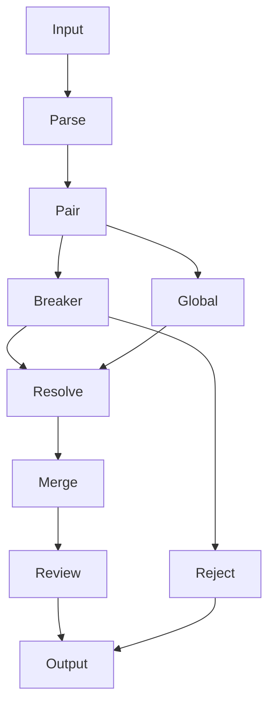

# skill-arbiter

[](https://github.com/Timevelyer/skill-arbiter/actions/workflows/validate.yml)
[](LICENSE)
[](https://github.com/Timevelyer/skill-arbiter/releases)
[](https://github.com/Timevelyer/skill-arbiter/stargazers)

English · [中文](README.md)

An offline, deterministic, auditable conflict checker and merger for **N `SKILL.md` files**. It runs pairwise analysis, then tri/n-ary checks, then global resolution — because pairwise compatibility does not imply combined compatibility.

## Why pairwise is not enough

SkillClash reports that when two skills for the same task are loaded together, single-skill rule-following (93–99%) drops to 61–62% ("takeover"). Those numbers come from the [paper and its public repository](https://github.com/prazmara/skillclash); this project does not independently reproduce them.

The practical consequence is the design premise here: **a clean pair matrix is only an intermediate artifact**. Every verdict has to survive tri/n-ary conflict checks, global resolution, and an adversarial pass.

## What it does

- Accepts two or more pasted `SKILL.md` files, or `BASE:` + `SKILL:` for incremental re-checks.
- Produces evidence-bound rule units, a pair matrix, a combined conflict graph, a disposition table, a minimal repair path, and one of: merged skill, decidable router, incremental report, or rejection report.
- Classifies every relation into six types: `exclusive`, `shared`, `entangled`, `contradictory`, `dependency-conflict`, `intent-conflict`.
- Grades severity S0–S3 with three hard rules: S3 never trips the circuit breaker alone; S0 may never be routed around; an L3 fingerprint hit never rejects on its own.
- Stays offline: it does not execute source skills, call their tools, or scan files you did not provide.

It is a specification and documentation toolkit driven by pasted text — not a semantic compiler. Structural checks do not stand in for real model probes, human scoring, or semantic review.

## Quick start

1. Copy the whole `skill-arbiter` directory (or just `SKILL.md`, `reference/`, `templates/`) into your agent's skills directory. Per-host notes live in `install/`.
2. Invoke `skill-arbiter` explicitly and paste at least two skills:

```text
SKILL: skill-a
---
name: skill-a
description: Example skill A
---
Output must include test results.

SKILL: skill-b
---
name: skill-b
description: Example skill B
---
Output must include a migration note.
```

3. Read the parse summary, relations with evidence, global verdict, disposition table, and the matching template output.
4. Before acting on any S0/S1 verdict, check the verbatim quotes from both sides, the adversarial pass, the minimal repair path, and the stated way to overturn the finding.

## Eight layers



Parse and atomize → pair analysis → circuit breaker → tri/n-ary checks → global resolution → merge with a worked example → adversarial review → output assembly.

Resolution order: decidable router (never bypassing S0) → conditional override → ordering/structure → parent/child split → rejection with a minimal repair path.

## Repository layout

| Path | Contents |
|---|---|
| `SKILL.md` | the skill itself: input protocol, layers, output contract |
| `reference/arbiter-rules.md` | full decision rules and evidence requirements |
| `templates/` | merged skill, router, rejection, incremental report |
| `install/` | per-host installation notes (Claude Code, Codex, OpenCode, DeepSeek, WorkBuddy, ZCode) |
| `tests/` | 37 acceptance cases, rubric, fixtures, golden regression texts |
| `OPERATIONS.md` | single-page usage and release runbook |
| `LAUNCH.md` | release checklist and remaining work |

## Evidence boundary

This section is deliberately explicit; the same table is in the Chinese README.

| Item | Status | Note |
|---|---|---|
| 21 core files, boundary markers, C01–C37 numbering | pass (static) | local equivalent check |
| `frontmatter` / `rubric-structure` / `golden` jobs | pass | local equivalent execution |
| Case-table conformance | pass | 37 spec rows align with 37 result rows |
| Release gate | pass on `v9.0.0` | probes actually run; five-dimension mean 4.00; sign-off recorded with its basis stated in `signoff_basis` |
| 37 semantic cases | **not executed** | owner chose to skip; `tests/case-results.md` is all `not-run` and must not be cited as passing |
| Six host installations | **not verified** | the repository was not installed into any host by request |

CI validates structure only. Only a `v*` tag enforces the human review gate. Do not read a green badge as proof that the semantic cases passed.

## License

[MIT](LICENSE). Issues and PRs are welcome; for conflict-analysis disagreements, include the verbatim lines from both skills.
