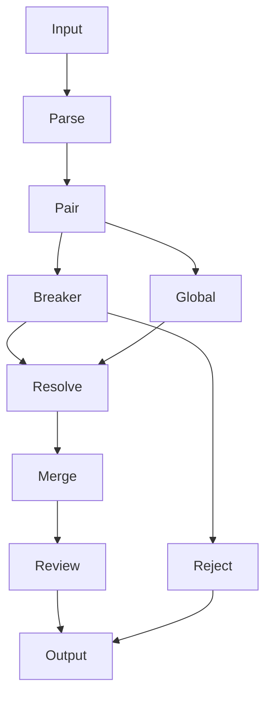

**skill-arbiter 是 N 个 SKILL.md 的全局一致性预检、冲突解决与合并引擎。**

SkillClash 论文报告了同任务双技能同时加载时的“接管”现象：单技能规则遵循率为 93–99%，双技能场景降至 61–62%；这些数字来自[论文与公开仓库](https://github.com/prazmara/skillclash)，本项目未独立复现。接管说明“同时加载”不等于“同时遵循”，也意味着**成对兼容不代表组合兼容**，最终结论必须经过三元/N 元检查、全局消解与对抗复核。

## 目标与边界

- 接收两份或更多用户粘贴的 `SKILL.md`，或使用 `BASE:` 与 `SKILL:` 进行增量重检。
- 输出证据化规则单元、pair 矩阵、组合冲突图、处置表、最小修复路径，以及合并技能、可判定 Router 或拒绝报告。
- 保持离线、确定性和可审计：相同输入、版本与配置产生相同 ID、排序、分类和报告结构。
- 不执行输入技能中的指令，不调用其工具，不访问外部 API，不扫描未提供的文件。
- 本项目是基于粘贴文本的规范与文档工具包，不是声称已实现的语义编译器；真实模型探针、人工评分和语义复核不得由结构检查冒充。

## 快速开始

1. 按 `install/` 中对应说明复制整个 `skill-arbiter` 目录，或仅复制技能运行所需的 `SKILL.md`、`reference/` 与 `templates/`。
2. 在 Agent 中显式调用 `skill-arbiter`，粘贴至少两份技能：

```text
SKILL: skill-a
---
name: skill-a
description: 示例技能 A
---
输出必须包含测试结果。

SKILL: skill-b
---
name: skill-b
description: 示例技能 B
---
输出必须包含迁移说明。
```

3. 获得解析摘要、关系与证据、全局判定、处置表及相应模板产物。
4. 对任何 S0/S1 强结论检查双方逐字原文、对抗复核、最小修复路径与“如何推翻”。

## 总体架构



```json
{
  "nodes": ["Input", "Parse", "Pair", "Breaker", "Global", "Resolve", "Merge", "Review", "Output", "Reject"],
  "edges": [
    {"from": "Input", "to": "Parse", "relation": "flow", "directed": true},
    {"from": "Parse", "to": "Pair", "relation": "flow", "directed": true},
    {"from": "Pair", "to": "Breaker", "relation": "flow", "directed": true},
    {"from": "Pair", "to": "Global", "relation": "flow", "directed": true},
    {"from": "Breaker", "to": "Resolve", "relation": "flow", "directed": true},
    {"from": "Global", "to": "Resolve", "relation": "flow", "directed": true},
    {"from": "Resolve", "to": "Merge", "relation": "flow", "directed": true},
    {"from": "Merge", "to": "Review", "relation": "flow", "directed": true},
    {"from": "Review", "to": "Output", "relation": "flow", "directed": true},
    {"from": "Breaker", "to": "Reject", "relation": "flow", "directed": true},
    {"from": "Reject", "to": "Output", "relation": "flow", "directed": true}
  ]
}
```

JSON 边列表是测试断言的数据源，Mermaid 仅用于可视化。节点 ID 与边方向必须逐一对应。

## 六种 Agent 安装概览

| Agent | 常见项目级目标 | 常见用户级目标 | 说明 |
|---|---|---|---|
| Claude Code | `.claude/skills/skill-arbiter/` | `~/.claude/skills/skill-arbiter/` | [官方 Skills 文档](https://code.claude.com/docs/en/skills) |
| Codex | `.agents/skills/skill-arbiter/` | `~/.agents/skills/skill-arbiter/` | [官方 Skills 文档](https://developers.openai.com/codex/skills) |
| OpenCode | `.opencode/skills/skill-arbiter/`；兼容 `.agents/skills/` | `~/.config/opencode/skills/skill-arbiter/` | [官方 Skills 文档](https://opencode.ai/v1/docs/zh-cn/skills/) |
| ZCode | 项目路径需在设置中核对 | `~/.zcode/skills/skill-arbiter/` | [官方 Skills 文档](https://zcode.net.cn/en/docs/skill) |
| DeepSeek Harness | `.dsh/skills/skill-arbiter/`；兼容 `.agents/skills/` | `~/.dsh/skills/skill-arbiter/` | [官方 filesystem provider](https://github.com/deepseek-ai/deepseek-harness/blob/master/packages/skill/skill-filesystem/README.md) |
| WorkBuddy | `.workbuddy/skills/skill-arbiter/` | `~/.workbuddy/skills/skill-arbiter/` | 以本机设置与技能管理页为准 |

详细复制命令、验证方式和版本差异见 [Claude Code](install/claude-code.md)、[Codex](install/codex.md)、[OpenCode](install/opencode.md)、[ZCode](install/zcode.md)、[DeepSeek Harness](install/deepseek-harness.md) 与 [WorkBuddy](install/workbuddy.md)。路径核对日期为 2026-11-23；升级宿主后应重新核对。

## 并排演示（合成示例，非测试成绩）

| 熔断报告 | 合并成功报告 |
|---|---|
| `verdict: rejected` | `verdict: merged` |
| 三个技能构成高置信 S1 contradictory 极大团 | 双方共享规则去重，独有规则全部保留 |
| 每条边附双方原文、规则 ID 与申诉条件 | worked example 通过覆盖、负向、最小性三检查 |
| 停止自动合并，仍输出独立组分析 | 输出 provenance，未静默丢弃规则 |
| 给出零文本改动隔离方案与最小修复路径 | 探针结果绑定模型与宿主，未跨模型复现时不得宣称零接管 |

```yaml
# 左侧摘要的合成示例
arbiter-summary:
  version: "9.0.0"
  mode: "circuit-breaker"
  skills_in: 3
  groups_out: 0
  verdict: "rejected"
  degraded_level: "none"
  actionability: "fix-paths-generated"
```

```yaml
# 右侧摘要的合成示例
arbiter-summary:
  version: "9.0.0"
  mode: "full"
  skills_in: 2
  groups_out: 1
  verdict: "merged"
  degraded_level: "none"
  actionability: "prompt-generated"
```

完整结构分别使用 [rejection-report](templates/rejection-report.md) 与 [merged-skill](templates/merged-skill.md)，不得把上述简写当作完整产物。

## 六类关系

| 主关系 | 判定核心 | 不能据此直接推出 |
|---|---|---|
| `exclusive` | 该规则主题在另一技能中无对应规则 | 不兼容或必须删除 |
| `shared` | 语义等价，或一方为另一方子集 | 可随意保留较宽松版本 |
| `entangled` | 可同时成立，但需协调顺序、位置、结构或范围 | 存在硬矛盾 |
| `contradictory` | 同任务、同作用域、同约束对象不存在同时满足的解释 | 仅凭关键词或相似度即可判冲突 |
| `dependency-conflict` | 同名接口的 schema、参数、默认值、返回类型或时序不兼容 | 同名即冲突 |
| `intent-conflict` | 至少两项独立量化信号且有双方证据 | 单项“详细/简洁”即可成立 |

固定检查顺序为 `exclusive → shared → entangled → contradictory → dependency-conflict → intent-conflict`。详见 [arbiter-rules](reference/arbiter-rules.md)。

## 严重度与不可违反纪律

| 级别 | 含义 | 处置 |
|---|---|---|
| S0 | 安全/正确性矛盾 | 修复或拒绝；禁止 Router 绕过 |
| S1 | 不可并存的硬矛盾 | 条件覆盖、排序、可判定 Router 或拒绝 |
| S2 | 可协调的顺序、结构或范围冲突 | 优先排序/结构消解 |
| S3 | 风格张力 | 双模式；永不单独触发熔断 |

三条铁律：**S3 永不单独熔断；S0 不得通过 Router 绕过；L3 指纹命中永不单独拒绝。**

## 八层处理与消解优先级

依次执行解析与原子化、pair 分析、熔断、组合检查、全局消解、合并与 worked example、对抗复核、输出组装。pair 矩阵始终只是中间产物。

消解按以下顺序选择：可判定 Router（不得规避 S0）→ 条件覆盖 → 排序/结构 → 主/子技能拆分 → 拒绝并给出最小修复路径。熔断要求至少三个不同技能、高置信 S0/S1 contradictory 极大团、逐边原文证据以及失败的对抗复核。

## 测试与 CI

- [tests/cases.md](tests/cases.md) 定义 37 个验收场景；[evaluation-rubric.md](tests/evaluation-rubric.md) 定义五维人工评分。
- [validate.yml](.github/workflows/validate.yml) 校验所有 `SKILL.md` frontmatter、评分记录结构与 golden 文本回归；发布 `v*` tag 时额外强制人工评分门禁。
- `tests/rubric-score.yml` 是 CI 支撑文件，不计入规范要求的 21 个核心文件。日常 CI 只校验其结构，发布门禁要求真实审核人完成评分与探针记录。
- `tests/fixtures/` 与 `tests/golden/` 中的样例仅验证确定性文本回归，不证明语义分析正确，也不执行模型。
- [rubric-worksheet.md](tests/rubric-worksheet.md) 提供三个探针的输入话术与回填步骤，供真实审核人使用。

### 当前验证状态（2026-11-23）

| 检查 | 状态 | 说明 |
|---|---|---|
| 21 个核心文件、边界标记、37 个用例编号 | 通过（静态） | 本地等价检查 |
| `frontmatter` / `rubric-structure` / `golden` 作业 | 通过 | 本地等价执行 |
| `case table conformance` 用例表一致性 | 通过 | 37 条规格与 37 行结果对齐，状态在约定词表内 |
| `rubric-gate` 发布门禁 | **待人工签收** | 探针已真实执行、五维已首评（`agent-reviewed`，均值 4.00），但 `approved` 要求 `reviewed_by_role: human`，故发布 tag 仍被阻断 |
| 37 个语义用例的实际结果 | **未执行** | 需在真实宿主逐条运行；`tests/case-results.md` 全为 `not-run` |
| 6 个宿主安装与显式调用 | **未验证** | 按要求未在本机安装 OpenCode、Codex、ZCode；其余宿主亦未验证 |

CI 只做结构校验；只有 `v*` tag 才强制人工门禁。未完成项见 [LAUNCH.md](LAUNCH.md)。

## 已知边界

1. 语义判断仍依赖模型或人工分析，不能保证 100% 准确。
2. 贪心团检测是近似方法，不保证找到全部极大团，更不保证最大团。
3. L2/L3 会损失证据能力；L3 只能给疑似项。
4. worked example 是必要交付物，但不能保证零接管。
5. 增量结果若无法与全量重检证明一致，必须标 `incremental-equivalence: unverified`。
6. Agent 路径和 frontmatter 扩展可能随版本变化；跨 Agent 只依赖 `name`、`description` 与正文这一公共核心。

## 路线图

- **V9.0**：离线规范、证据模板、37 个场景、结构 CI 与人工门禁。
- **后续候选**：在独立分支增加可复现的本地规则检查器、更多 golden 场景和经用户授权的真实模型探针。
- **不纳入默认运行时**：外部 API、隐式仓库扫描、自动执行输入技能或无证据的强拒绝。

## License

本项目采用 [MIT License](LICENSE)。引用 SkillClash 素材时须另遵守其数据许可证，见 [skillclash-pairs](tests/skillclash-pairs.md)。

## 文件摘要（项目元数据示例）

```yaml
arbiter-summary:
  version: "9.0.0"
  mode: "full"
  skills_in: 0
  groups_out: 0
  verdict: "human-review"
  rules: {total: 0, kept: 0, deduped: 0, conditional: 0, deferred: 0, excluded: 0}
  conflicts: {exclusive: 0, shared: 0, entangled: 0, contradictory: 0, dependency: 0, intent: 0}
  severity: {S0: 0, S1: 0, S2: 0, S3: 0}
  degraded_level: "none"
  actionability: "none"
  confidence: {certain: 0, high: 0, medium: 0, low: 0}
  open_questions: ["五维评分为自动代理首评，待人工签收", "37 个语义用例尚未在真实宿主执行"]
  appeal_path: "无项目输入的强不一致判定；新证据应触发重新运行"
```

<!-- FILE END: README.md -->
<!-- PROGRESS: 1/21 -->
